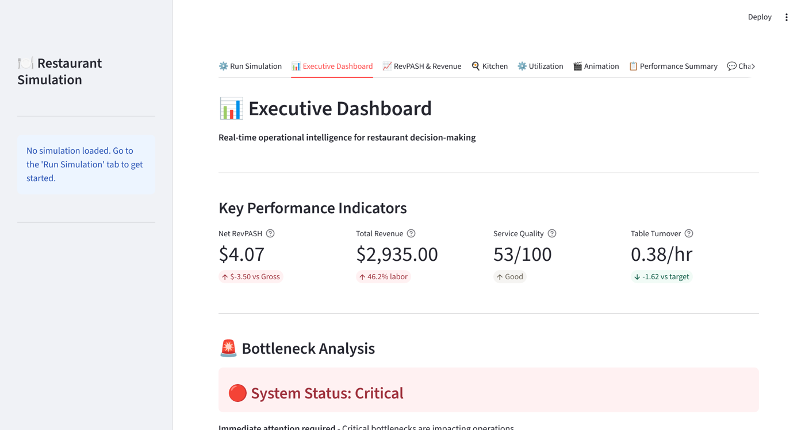
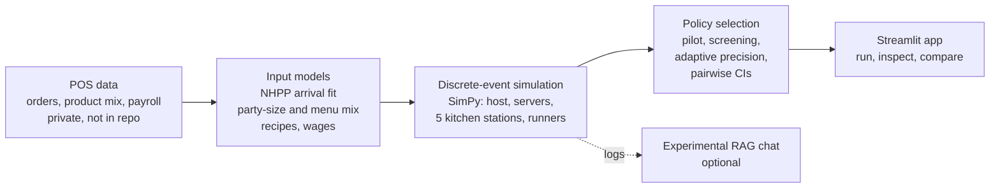

# Restaurant Staffing Optimization

**Discrete-event simulation of a busy Berkeley restaurant (Comal) to choose how many servers, cooks, hosts, food runners and bussers to schedule, using statistical selection to pick a winner with confidence.**

**[Live app](https://restaurant-staffing-optimization.streamlit.app/)** · [Project report (PDF)](docs/IEOR_174_Project_Report.pdf) · Built for IEOR 174 (Simulation), UC Berkeley



## The problem and the result

Restaurant labor is the largest controllable cost, and the "right" crew is not obvious: a kitchen can look 70% utilized on average while one station (the wood grill) is saturated and stalls every table. I built a SimPy discrete-event model of a Friday dinner service (arrivals, host seating, server zones, five kitchen stations, food runners, bussing) with arrival rates fitted to about two months (Oct-Nov 2025) of the restaurant's real point-of-sale data. I then compared 36 staffing configurations on **net revenue per available seat-hour** (revenue minus labor cost, divided by seat-hours).

**Result:** among the configurations tested, **5 servers, 9 cooks, 1 host, 1 food runner, 0 bussers** scored best at **$3.81 per seat-hour (95% CI $3.64-$3.99)**. Kitchen staffing dominated: with 8 cooks the grill station collapses and throughput stalls, while a 10th cook added cost without enough extra revenue.

| Rank | Config (servers/cooks/hosts/runners/bussers) | Net RevPASH | 95% CI |
|---|---|---|---|
| 1 | 5 / 9 / 1 / 1 / 0 | $3.81 | [$3.64, $3.99] |
| 2 | 5 / 9 / 1 / 2 / 0 | $3.46 | [$3.28, $3.63] |
| 3 | 5 / 10 / 1 / 1 / 0 | $3.42 | [$3.21, $3.62] |
| 4 | 6 / 9 / 1 / 1 / 0 | $3.33 | [$3.15, $3.51] |
| 5 | 5 / 10 / 1 / 2 / 0 | $3.30 | [$3.11, $3.48] |

Source: the project report, §5.1 ([notebook](notebooks/statistical_testing.ipynb) reproduces the workflow). The winner beat its nearest competitor (a second food runner) with a statistically significant margin; the gaps among ranks 2-5 were not all significant.

**Caveats, read these:** these are *simulated* results from a model, not measured outcomes in the restaurant. The model represents an average Friday dinner (5 PM onward) fitted from roughly two months of data, so seasonality, other days and special events are not captured. Net RevPASH counts labor only (no food cost, rent, or tips), only 36 combinations on a coarse grid were searched (servers 5-7, cooks 8-10, runners 1-2, bussers 0-1), and service times are modeled assumptions rather than measured. Treat the output as a ranking of options to test, not a staffing mandate.

## How it works



| Module | What it does |
|---|---|
| [`engine/`](engine) | Simulation engine: `simulation.py` (events/processes), `parameters.py`, `models.py`, `results.py`, `comal_recipes.json` (menu, recipes, prices) |
| [`engine/selection.py`](engine/selection.py), [`statistical_validation.py`](engine/statistical_validation.py) | Statistics: pilot, subset selection, adaptive stopping, pairwise comparison, CRN pairs |
| [`gui/`](gui) | Streamlit app (`streamlit_app.py` is the entrypoint) |
| [`gui/rag/`](gui/rag) | **Experimental** LLM chat over simulation logs |
| [`data/`](data) | Synthetic sample orders + how they were generated |
| [`tests/`](tests) | Fast tests (engine, selection, CRN) |
| [`notebooks/`](notebooks) | The analysis notebooks behind the report |

## Methodology (plain English)

- **Discrete-event simulation.** Time jumps from one event to the next (a party arrives, a dish finishes, a table is cleaned) instead of ticking every second. Each party walks through seating, ordering, cooking, eating, paying and bussing, competing for limited servers, cooks and tables. Arrivals follow a time-varying Poisson process (busy peak, quiet shoulders) fitted to real data.
- **Pilot runs and an adaptive stopping rule.** Results are noisy, so each configuration is run many times. A 30-run pilot estimates the variance and the number of runs needed for a 5% relative confidence-interval width; the study then keeps adding replications until the 95% CI half-width is within 5% of the mean. Required runs ranged from 21 to 87 per configuration.
- **Two-stage selection.** Stage one screens all 36 configurations with just 10 runs each and drops any whose Bonferroni-adjusted upper confidence bound falls below the current best (36 down to 11). Stage two spends the compute budget only on the survivors, to the 5% precision target.
- **Common random numbers (CRN).** When comparing two configurations, running both on the *same* random seeds makes the same "bad luck" (a big party rush) hit both, so the difference is far less noisy.

## Results provenance

Numbers above come from the report and the executed notebook outputs; nothing was re-tuned for this README. The 36-configuration search, 10-run screen and 21-87-run precision study are as described in the report. If you re-run the notebook on your machine, expect values to differ slightly with different seeds.

## Run locally

```bash
git clone https://github.com/zhouhaitz/restaurant-staffing-optimization.git
cd restaurant-staffing-optimization
python -m venv .venv && source .venv/bin/activate     # Python 3.12+
pip install -r requirements.txt
streamlit run streamlit_app.py
```

Run the simulator from Python:

```python
import sys; sys.path.insert(0, "engine")
from dish_loading import load_recipes_from_json
from runner import run_single_dish_sim

params = load_recipes_from_json("engine/comal_recipes.json")
print(run_single_dish_sim(params)["net_revpash"])
```

Tests and notebooks: `pip install -r requirements-dev.txt && pytest tests`.

## Data and privacy

The raw POS and payroll exports are **not** in this repo. The app and simulator don't read them at runtime; they run from fitted parameters. `data/` has a synthetic sample and a description of how it was made: see [`data/README.md`](data/README.md).

## Experimental: RAG chat assistant

A chat tab lets you ask questions about a simulation run (OpenAI `gpt-4o-mini` + in-memory ChromaDB over the run logs). **It was an experiment and is not reliably accurate**; always check numbers against the dashboards. It is optional and only enabled when you provide a key:

```bash
cp .env.example .env     # then set OPENAI_API_KEY (or use Streamlit secrets in the cloud)
```
